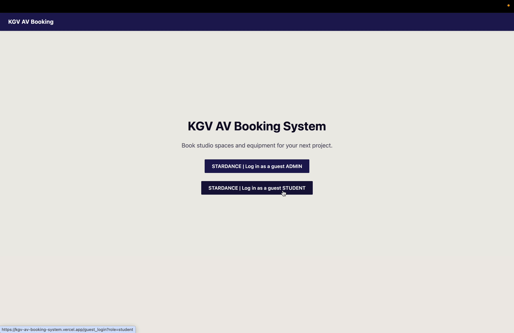

# School Media Equipment Booking System

A Flask AV equipment booking system for my school with dedicated pages for students and admin. 

**Open the link to demo: 
https://kgv-av-booking-system.vercel.app/**

5. Features

- Student interface that allows users to book equipment and media studio by inputting equipment type, quantity, date range of loan, reason for loaning and special requirements. Before booking submission, these criteria must be met:
* Equipment is permitted for their year group
* No outstanding overdue loans
* Requested loan quantity is below or equal to equipment loan limit
* Request equipment is available 
* Requested date range is below or equal to maximum number of loan days 
* Agreed to user agreement (checkbox)

- Media admin interface allowing approval/rejection of loans, overview information on upcoming loan dates and due dates. The admin interface allows for:
* Approval/rejection of loan triggers automated email to the student (disabled in the demo)
* Sort loans by the following filters: Current loans, upcoming loans, overdue loans.
* View the following information for all students: Name, year group, email. 

- Media admin interface with check out and check in interface, which display alerts if the student has overdue equipment.

7. How it works

### Database design

**Equipment types vs. individual assets.** Equipment is stored at two levels. `equipment_type` is what a student picks from, e.g. "Canon 60D", along with the rules for that type: how many the school owns, the minimum year group etc. `asset` is each physical item, identified by the barcode label on it. Students book a type rather than a specific item, because they don't mind which Canon 60D they get. The admin decides that when the student checks out the equipment.

**One row per item, barcode filled in at check-out.** When a student submits a booking, one row is created in `equipment_loan` (dates, reason, status), plus one row per item in `equipment_loan_item`. Booking two Canon 60Ds creates two rows, even though they're the same type. Each row's `fk_asset_barcode` starts empty, because no specific camera has been assigned yet. When the student collects the equipment, the admin scans each item's barcode and it's saved into one of those rows. Splitting it this way means:
- availability can be counted per type before any item is assigned
- after check-out, the system knows exactly which physical items each student has, so returns are checked by scanning item by item
- check-out rejects a barcode that doesn't exist, or one belonging to an item that isn't available

### Booking rules

The equipment page doesn't let a student choose any equipment until they've picked dates, because availability depends on the date range. Once dates are picked, the page asks the server (`/get_available_equipment`) how many of each type are available. For each type, the server:
1. returns "off limits" if the student's year group is below the type's minimum
2. counts the items of that type in pending or confirmed loans whose dates overlap the requested range
3. returns what's left, capped at the per-student loan limit

The page then only allows quantities up to that number. The other rules are checked in the browser: loans can be at most 3 days, the booking reason and both user agreement checkboxes are required, and students with an overdue loan see a notice telling them to return it before borrowing again.

8. Credits / acknowledgements

**Built with:** Flask, SQLAlchemy, MySQL ([TiDB Cloud](https://www.pingcap.com/tidb-cloud/)), Google sign-in via Authlib, hosted on [Vercel](https://vercel.com/).

**Credits**
- [Font Awesome Free](https://fontawesome.com/): icons ([CC BY 4.0](https://fontawesome.com/license/free))
- [flatpickr](https://flatpickr.js.org/): date pickers

**AI assistance**
I used Claude to help with the following:
- Deployment setup - moving the database to TiDB Cloud and configuring the app to run on Vercel.
- Debugging errors